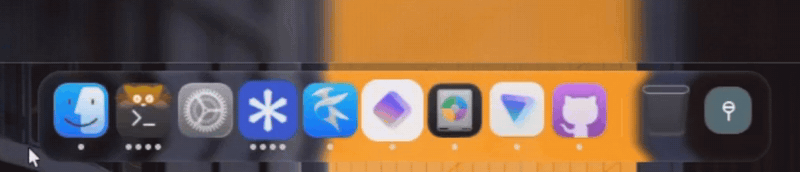
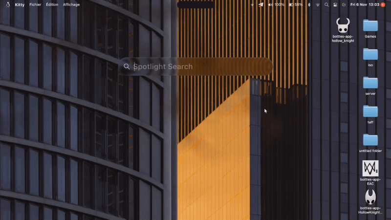

<div align="center">

**🇬🇧 [English](README.md)** · **🇫🇷 Français**

# 【 lickintosh 】

**Une interface de bureau inspirée de macOS Tahoe pour Hyprland, écrite avec [Quickshell](https://quickshell.org).**


[Fonctionnalités](#-fonctionnalités-) · [Installation](#-installation-) · [Raccourcis](#-raccourcis-clavier-) · [Configuration](#-configuration-) · [FAQ](#-faq-) · [Remerciements](#-remerciements-et-licences-)

</div>


> [!WARNING]
> **Version : bêta 1.** Le projet fonctionne au quotidien sur ma machine (lol), mais je n'ai pas pu le tester sur beaucoup de configurations. Attends-toi à des bugs par endroit, et ouvre une issue quand tu en trouves un.


## • fonctionnalités •

**Barre supérieure**
- **Menu Apple** : À propos, Réglages Système, App Store (ouvre la page des paquets officiels de ta distribution), Éléments récents, Forcer à quitter, Suspendre, Redémarrer, Éteindre, Se déconnecter, Verrouiller.
- **Menu global** : le menu de l'application active, avec des modèles par type d'application (navigateur, gestionnaire de fichiers, IDE, messagerie, lecteur multimédia, design, etc.).


- **Zone d'état** : Wi-Fi, Bluetooth, volume, batterie, Spotlight, assistant IA, Centre de contrôle, centre de notifications, zone de notification (tray), horloge.

- **Notch** : une pastille qui s'étend pour les notifications et les contenus en cours. Elle respecte le mode Concentration et peut être désactivée dans les réglages.

**Dock**
- **Applications** : épinglées, avec indicateurs d'applications ouvertes, corbeille et grossissement au survol.
- **Réglages** : taille des icônes, échelle du dock et débordement des icônes.


<p align="center"></p>


**Bureau**
- **Icônes de fichiers** : grille, sélection multiple, déplacement avec permutation animée.
- **Widgets** : batterie, Bluetooth, calendrier, horloge analogique et numérique, Concentration, média, notes, citation, chronomètre, tâches, minuteur, volume, météo. Trois thèmes : verre, clair et sombre.

**Centre de contrôle**
- **Contrôles modifiables** : Wi-Fi, lecture en cours, Bluetooth, KDE Connect, Concentration, capture d'écran, partage d'écran, luminosité, son, mode sombre, calculatrice, mode jeu, minuteur, alarme, chronomètre, maintien en éveil.


**Spotlight**
- **Sources** : applications, fichiers (dont les fichiers récents), actions système, calculatrice, historique du presse-papiers (texte et images).
- **Réglages** : chaque source s'active ou se désactive, avec des préfixes pour cibler un mode.


<p align="center"></p>


**Écran de verrouillage**
- **Authentification** par PAM, styles d'horloge, lecteur multimédia et notifications.
- **Verrouillage au démarrage** : l'écran de verrouillage s'affiche avant l'interface.
- **`hypridle`** : verrouillage, extinction de l'écran, mise en veille.


**Autres**
- **Affichages à l'écran** pour le volume et la luminosité, popups de notifications et de batterie.
- **Assistant IA** avec quatre fournisseurs : Anthropic, OpenAI, Google (Gemini) et Ollama (local).
- **Application de réglages** : compte, IA, apparence, batterie, Bluetooth, Centre de contrôle, Dock, général, écran de verrouillage, moniteurs, Spotlight, barre supérieure, fond d'écran, Wi-Fi.


## • prérequis •

| Élément | Détail |
|---|---|
| **Hyprland** | 0.57 ou plus (la configuration fournie utilise la configuration Lua) |
| **Quickshell** | 0.3 ou plus, avec les modules Qt 6 `QtGraphs`, `QtQuick.VectorImage`, `QtDeclarative` et `QtWayland` |
| **Outils** | Python 3, ImageMagick, `brightnessctl`, `playerctl`, `wl-clipboard`, `grim`, `slurp`, `hyprpicker`, `jq`, `curl`, `xdg-utils`, `xdg-user-dirs`, PipeWire (`pw-dump`), WirePlumber (`wpctl`), NetworkManager (`nmcli`) |
| **Services** | NetworkManager, BlueZ, UPower, power-profiles-daemon |
| **Configuration Hyprland fournie** | `hypridle`, `cliphist`, `hyprpolkitagent`, et les programmes de `assets/config/hypr/hyprlua/programs.lua` (terminal, gestionnaire de fichiers, navigateur, éditeur de code, lecteur multimédia) que tu peux remplacer par les tiens |

## • installation •

```fish
git clone https://github.com/kelian-4/lickintosh.git
cd lickintosh
./setup.fish
```

Le script est écrit pour fish. Ne le lance pas en root : il demande `sudo` (ou `doas`) lui-même quand il en a besoin.

| Option | Effet |
|---|---|
| `--skip-deps` | Ne vérifie ni n'installe les dépendances |
| `--no-launch` | N'essaie pas de lancer le shell à la fin |
| `--doctor` | Vérifie toute l'installation (session, Hyprland, modules Quickshell, outils, services, fichiers installés, erreurs récentes) et explique chaque problème |
| `--uninstall` | Retire le shell après une sauvegarde (tes réglages, polices, icônes et curseur sont conservés sauf si tu le demandes) |

Si Quickshell tourne déjà, relance-le complètement pour charger la nouvelle copie.

> [!TIP]
> **Mise à jour** : `git pull` puis relance `./setup.fish`. Une méthode plus conviviale arrivera plus tard.

> [!NOTE]
> Le shell est lancé par `tools/lickintosh-start` : il attend Hyprland, ne démarre jamais une deuxième copie, relance le shell après un plantage et, après plusieurs plantages rapides, essaie des réglages graphiques plus simples. Le journal est dans `~/.local/state/lickintosh/shell.log`. Tes propres variables d'environnement vont dans `~/.config/lickintosh/env`.

## • raccourcis clavier •

Le modificateur principal est `SUPER`.

| Raccourci | Action |
|---|---|
| `SUPER + Espace` | Spotlight |
| `CTRL + SUPER + Q` | Verrouiller l'écran |
| `SUPER + T` | Terminal |
| `SUPER + D` | Gestionnaire de fichiers |
| `SUPER + B` | Navigateur |
| `SUPER + C` | Éditeur de code |
| `SUPER + M` | Lecteur multimédia |
| `SUPER + Q` | Fermer la fenêtre |
| `SUPER + F` | Plein écran |
| `SUPER + V` | Fenêtre flottante |
| `ALT + Tab` / `ALT + SHIFT + Tab` | Sélecteur d'applications (maintiens ALT, tape Tab pour défiler, relâche ALT pour basculer) |
| `SUPER + Tab` / `SUPER + SHIFT + Tab` | Fenêtre suivante / précédente |
| `SUPER + flèches` | Changer le focus |
| `SUPER + SHIFT + flèches` | Déplacer la fenêtre |
| `SUPER + ALT + flèches` | Redimensionner la fenêtre |
| `SUPER + 1` à `0` | Aller à l'espace de travail 1 à 10 |
| `SUPER + SHIFT + 1` à `0` | Envoyer la fenêtre à l'espace de travail |
| `CTRL + SUPER + gauche` / `droite` | Espace de travail précédent / suivant |
| `SUPER + S` | Espace de travail spécial |
| `SUPER + Impr` | Capture d'une zone, enregistrée dans `~/Pictures/Screenshots` et copiée |
| `SUPER + SHIFT + Impr` | Capture d'une zone, copiée seulement |
| `ALT + SUPER + Échap` | Tuer une fenêtre (`hyprctl kill`) |

## • configuration •

Presque tout se règle dans l'application **Réglages**, ouverte depuis le menu Apple (« Réglages Système… ») ou le dock. Les valeurs sont enregistrées par le shell dans son fichier de configuration.

<p align="center">


</p>


## • structure du dépôt •

| Dossier | Contenu |
|---|---|
| `shell.qml`, `settings.qml` | Points d'entrée du shell et de l'application de réglages |
| `ui/` | Interface : barre, dock, bureau, verrouillage, OSD, réglages, widgets |
| `components/` | Composants réutilisables (boutons, curseurs, verre, etc.) |
| `services/` | Services et états partagés (réseau, Bluetooth, thème, configuration, langue, etc.) |
| `assets/` | Icônes, polices, curseur, fonds d'écran, shaders, traductions (`assets/i18n`) et configuration Hyprland |
| `tools/` | Scripts d'appoint (historique de batterie, énergie, calculatrice, vignettes, shaders Liquid Glass) |
| `docs/` | Notes de recherche, dont `liquid-glass-research.md` |
| `setup.fish` | Script d'installation |

Les shaders Liquid Glass se recompilent avec `tools/liquid-glass/build-shaders.sh`.

## • faq •

### Comment changer la langue ?
La langue du système est détectée au lancement (français, anglais ou espagnol, anglais par défaut). Pour la forcer : **Réglages › Général › Langue et région**.

### Pourquoi les fenêtres n'ont-elles pas le style macOS Tahoe ?
Je travaille encore sur des thèmes pour les fenêtres.

### Ma distribution n'est pas Arch, Debian ou Fedora, que faire ?
Seules ces familles bénéficient de l'installation automatique des dépendances. Sur les autres, installe les paquets de la section [prérequis](#-prérequis-) à la main, puis lance `./setup.fish --skip-deps`.
Tu peux aussi procéder manuellement ou, mieux, contribuer au script.

### Quickshell est introuvable dans mes dépôts
Il n'est pas présent dans toutes les versions d'Arch, Debian et Fedora : le script l'indique et propose le dépôt tiers adapté.

### Certains textes ne sont pas traduits
Les traductions anglaise et espagnole sont récentes et peuvent contenir des erreurs. Certains textes restent en français : messages de l'assistant IA et du script d'installation. Ouvre une issue pour les signaler, ou, mieux, contribue à la traduction du projet.

## • remerciements et licences •

- **Liquid Glass** : l'effet est adapté de [OverShifted/LiquidGlass](https://github.com/OverShifted/LiquidGlass) (licence MIT). Le texte de la licence est dans `THIRD_PARTY_LICENSES/LiquidGlass-MIT.txt`.
- **MacShell** : le widget « Lecture en cours », le lecteur de l'écran de verrouillage et les idées du lanceur de démarrage, de `--doctor`/`--uninstall` et du sélecteur Alt+Tab viennent de [0-ss/MacShell](https://github.com/0-ss/MacShell) (licence MIT). Le texte de la licence est dans `THIRD_PARTY_LICENSES/MacShell-MIT.txt`.
- **MacTahoe Liquid KDE** : voir `THIRD_PARTY_LICENSES/MacTahoeLiquidKDE-GPL-3.0.txt` (GPL-3.0).
- **Icônes** : thème [MacTahoe-icon-theme](https://github.com/vinceliuice/MacTahoe-icon-theme) de vinceliuice, variante « bold ».
- **Polices SF, curseur et fonds d'écran** : fournis dans `assets/`. Leurs droits appartiennent à leurs auteurs respectifs (les polices San Francisco et les fonds d'écran macOS sont des ressources d'Apple).

lickintosh est un projet indépendant, sans lien avec Apple. macOS et Tahoe sont des marques d'Apple Inc.

## • licence •

[PolyForm Noncommercial 1.0.0](https://polyformproject.org/licenses/noncommercial/1.0.0/).
