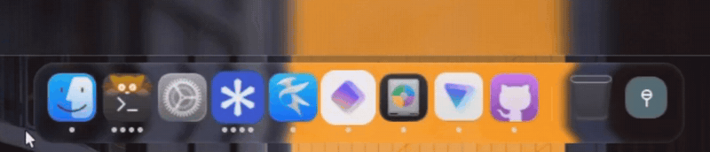
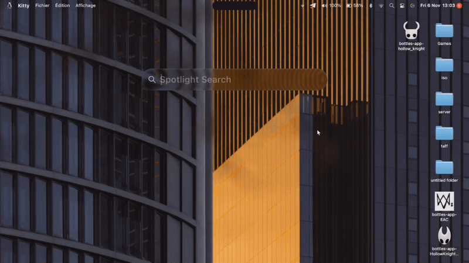

<div align="center">

**🇬🇧 English** · **🇫🇷 [Français](README.fr.md)**

# 【 lickintosh 】

**A macOS Tahoe-inspired desktop shell for Hyprland, built with [Quickshell](https://quickshell.org).**


[Features](#-features-) · [Installation](#-installation-) · [Keybinds](#-keybinds-) · [Configuration](#-configuration-) · [FAQ](#-faq-) · [Credits](#-credits-and-licenses-)

</div>


> [!WARNING]
> **Version: beta 1.** The project runs daily on my machine (lol), but I haven't been able to test it on many setups. Expect bugs here and there, and please open an issue when you find one.


## • features •

**Top bar**
- **Apple menu**: About, System Settings, App Store (opens your distribution's official package page), Recent Items, Force Quit, Sleep, Restart, Shut Down, Log Out, Lock.
- **Global menu**: the active application's menu, with templates per app type (browser, file manager, IDE, messaging, media player, design, etc.).


- **Status area**: Wi-Fi, Bluetooth, volume, battery, Spotlight, AI assistant, Control Center, notification center, system tray, clock.

- **Notch**: a pill that expands for notifications and ongoing activity. It respects Focus mode and can be turned off in the settings.

**Dock**
- **Applications**: pinned apps, running-app indicators, trash and hover magnification.
- **Settings**: icon size, dock scale and icon overflow.


<p align="center"></p>


**Desktop**
- **File icons**: grid, multi-selection, drag and drop with animated swapping.
- **Widgets**: battery, Bluetooth, calendar, analog and digital clocks, Focus, media, notes, quote, stopwatch, tasks, timer, volume, weather. Three themes: glass, light and dark.

**Control Center**
- **Editable controls**: Wi-Fi, now playing, Bluetooth, KDE Connect, Focus, screenshot, screen sharing, brightness, sound, dark mode, calculator, game mode, timer, alarm, stopwatch, keep awake.


**Spotlight**
- **Sources**: applications, files (including recent files), system actions, calculator, clipboard history (text and images).
- **Settings**: each source can be turned on or off, with prefixes to target a specific mode.


<p align="center"></p>


**Lock screen**
- **Authentication** through PAM, clock styles, media player and notifications.
- **Lock at startup**: the lock screen appears before the interface.
- **`hypridle`**: lock, screen off, suspend.


**Other**
- **On-screen displays** for volume and brightness, notification and battery popups.
- **AI assistant** with four providers: Anthropic, OpenAI, Google (Gemini) and Ollama (local).
- **Settings app**: account, AI, appearance, battery, Bluetooth, Control Center, Dock, general, lock screen, monitors, Spotlight, top bar, wallpaper, Wi-Fi.


## • requirements •

| Item | Details |
|---|---|
| **Hyprland** | 0.57 or newer (the bundled configuration uses the Lua config) |
| **Quickshell** | 0.3 or newer, with the Qt 6 modules `QtGraphs`, `QtQuick.VectorImage`, `QtDeclarative` and `QtWayland` |
| **Tools** | Python 3 (terminal calculator), ImageMagick, `brightnessctl`, `playerctl`, `wl-clipboard`, `grim`, `slurp`, `hyprpicker`, `jq`, `curl`, `xdg-utils`, `xdg-user-dirs`, PipeWire (`pw-dump`), WirePlumber (`wpctl`), NetworkManager (`nmcli`) |
| **Services** | NetworkManager, BlueZ, UPower, power-profiles-daemon |
| **Bundled Hyprland config** | `hypridle`, `cliphist`, `hyprpolkitagent`, and the programs from `assets/config/hypr/hyprlua/programs.lua` (terminal, file manager, browser, code editor, media player), which you can replace with your own |

## • installation •

```fish
git clone https://github.com/kelian-4/lickintosh.git
cd lickintosh
./setup.fish
```

The script is written for fish. Don't run it as root: it asks for `sudo` (or `doas`) itself when needed.

| Option | Effect |
|---|---|
| `--skip-deps` | Doesn't check or install dependencies |
| `--no-launch` | Doesn't try to start the shell at the end |

If Quickshell is already running, restart it completely to load the new copy.

> [!TIP]
> **Updating**: run `git pull`, then `./setup.fish` again. A friendlier method will come later.

## • keybinds •

The main modifier is `SUPER`.

| Shortcut | Action |
|---|---|
| `SUPER + Space` | Spotlight |
| `CTRL + SUPER + Q` | Lock the screen |
| `SUPER + T` | Terminal |
| `SUPER + D` | File manager |
| `SUPER + B` | Browser |
| `SUPER + C` | Code editor |
| `SUPER + M` | Media player |
| `SUPER + Q` | Close the window |
| `SUPER + F` | Fullscreen |
| `SUPER + V` | Floating window |
| `SUPER + Tab` / `SUPER + SHIFT + Tab` | Next / previous window |
| `SUPER + arrows` | Change focus |
| `SUPER + SHIFT + arrows` | Move the window |
| `SUPER + ALT + arrows` | Resize the window |
| `SUPER + 1` to `0` | Go to workspace 1 to 10 |
| `SUPER + SHIFT + 1` to `0` | Send the window to a workspace |
| `CTRL + SUPER + left` / `right` | Previous / next workspace |
| `SUPER + S` | Special workspace |
| `SUPER + Print` | Area screenshot, saved to `~/Pictures/Screenshots` and copied |
| `SUPER + SHIFT + Print` | Area screenshot, copied only |
| `ALT + SUPER + Escape` | Kill a window (`hyprctl kill`) |

## • configuration •

Almost everything is set in the **Settings** app, opened from the Apple menu ("System Settings…") or the dock. Values are saved by the shell in its configuration file.

<p align="center">


</p>


## • repository layout •

| Folder | Contents |
|---|---|
| `shell.qml`, `settings.qml` | Entry points of the shell and of the settings app |
| `ui/` | Interface: bar, dock, desktop, lock screen, OSD, settings, widgets |
| `components/` | Reusable components (buttons, sliders, glass, etc.) |
| `services/` | Shared services and state (network, Bluetooth, theme, configuration, language, etc.) |
| `assets/` | Icons, fonts, cursor, wallpapers, shaders, translations (`assets/i18n`) and Hyprland configuration |
| `tools/` | Helper scripts (battery history, power, calculator, thumbnails, Liquid Glass shaders) |
| `docs/` | Research notes, including `liquid-glass-research.md` |
| `setup.fish` | Installation script |

The Liquid Glass shaders are rebuilt with `tools/liquid-glass/build-shaders.sh`.

## • faq •

### How do I change the language?
The system language is detected at launch (French, English or Spanish, English by default). To force one: **Settings › General › Language & Region**.

### Why don't windows have the macOS Tahoe style?
I'm still working on window themes.

### My distribution isn't Arch, Debian or Fedora, what do I do?
Only those families get automatic dependency installation. On others, install the packages from the [requirements](#-requirements-) section by hand, then run `./setup.fish --skip-deps`.
You can also set things up manually or, even better, contribute to the script.

### Quickshell isn't in my repositories
It isn't available in every Arch, Debian and Fedora release: the script tells you and suggests the matching third-party repository.

### Some texts aren't translated
The English and Spanish translations are recent and may contain mistakes. Some texts remain in French: AI assistant messages and the installation script. Open an issue to report them or, even better, contribute to the project's translation.

## • credits and licenses •

- **Liquid Glass**: the effect is adapted from [OverShifted/LiquidGlass](https://github.com/OverShifted/LiquidGlass) (MIT license). The license text is in `THIRD_PARTY_LICENSES/LiquidGlass-MIT.txt`.
- **Media player**: the "Now Playing" widget and the lock screen player are adapted from [0-ss/MacShell](https://github.com/0-ss/MacShell) (MIT license). The license text is in `THIRD_PARTY_LICENSES/MacShell-MIT.txt`.
- **MacTahoe Liquid KDE**: see `THIRD_PARTY_LICENSES/MacTahoeLiquidKDE-GPL-3.0.txt` (GPL-3.0).
- **Icons**: [MacTahoe-icon-theme](https://github.com/vinceliuice/MacTahoe-icon-theme) by vinceliuice, "bold" variant.
- **SF fonts, cursor and wallpapers**: shipped in `assets/`. Their rights belong to their respective authors (the San Francisco fonts and the macOS wallpapers are Apple resources).

lickintosh is an independent project, not affiliated with Apple. macOS and Tahoe are trademarks of Apple Inc.

## • license •

[PolyForm Noncommercial 1.0.0](https://polyformproject.org/licenses/noncommercial/1.0.0/).
